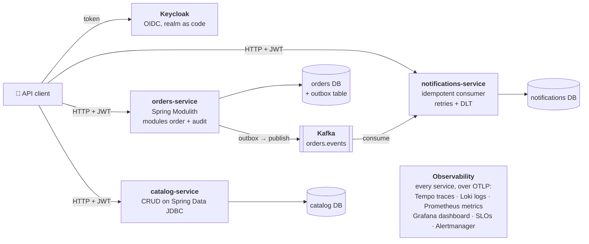
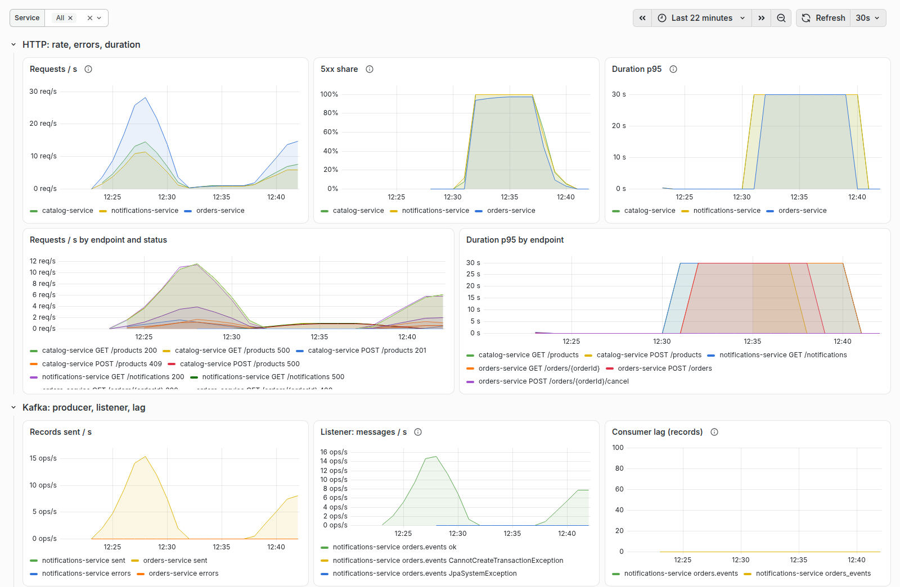
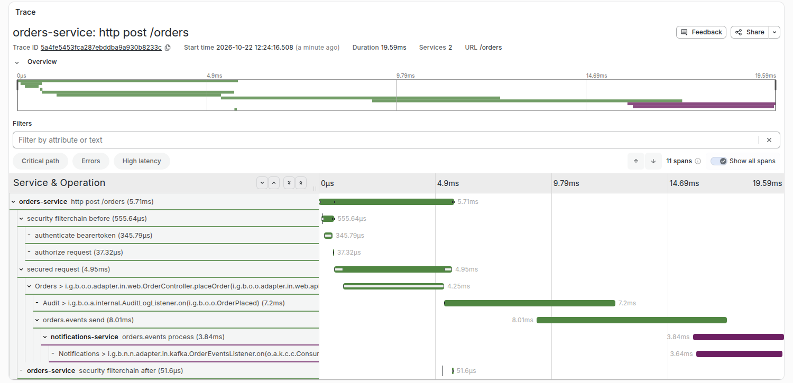
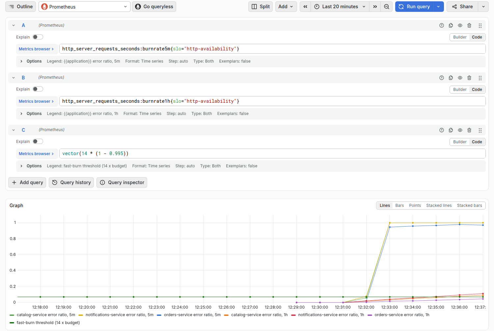
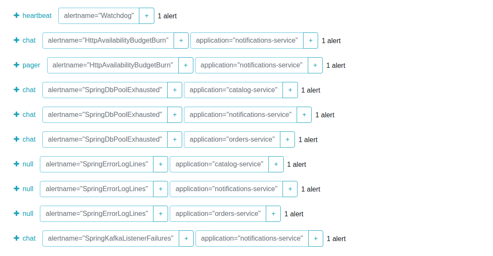

# Java microservices reference architecture

[](https://github.com/bsamsonov/java-microservices-reference-architecture/actions/workflows/ci.yml)
[](LICENSE)


A runnable microservice platform and two service templates on Java 25 and Spring Boot 4.1, for architects and Java teams
who want new services built quickly with an AI coding agent while the build enforces the architecture rules.

It has three services on Postgres, Kafka, Keycloak and OpenTelemetry, with a shared dashboard, SLOs and alerts. The same jars and images run
on a laptop with Docker Compose and on Kubernetes with k3d and Helm ([ADR-0017](docs/adr/0017-two-run-modes-same-artifacts.md)).



```bash
make demo   # builds the services, starts the stack, places and cancels an order, prints its trace link
make down   # stops everything and deletes the data
```

Needs Docker, Java 25, `curl` and `jq`; the first run takes a few minutes. Then:
[architecture overview](docs/architecture/README.md) · [decisions (ADRs)](docs/adr/README.md) ·
[templates and the `create-service` skill](.claude/skills/create-service/SKILL.md) · [how AI was used](docs/ai-workflow.md)

## What is inside

| Part | Where |
|---|---|
| `orders-service`: Spring Modulith (modules `order` and `audit`), a domain model in a light hexagon, a transactional outbox to Kafka | [`services/orders-service/`](services/orders-service/README.md) |
| `notifications-service`: a Kafka consumer, idempotent by `eventId`, with retries and a dead-letter topic | [`services/notifications-service/`](services/notifications-service/README.md) |
| `catalog-service`: a small CRUD on Spring Data JDBC with optimistic locking, no Modulith | [`services/catalog-service/`](services/catalog-service/README.md) |
| Two templates (orders and catalog) and a skill that scaffolds a new service from them | [`.claude/skills/create-service/`](.claude/skills/create-service/SKILL.md) |
| Laptop mode: Postgres, Kafka, Keycloak, Grafana LGTM, Alertmanager in Docker Compose | [`compose/`](compose/README.md) |
| Kubernetes mode: k3d, CloudNativePG, Strimzi, Keycloak, kube-prometheus-stack, Loki, Tempo, OTel Collector, default-deny NetworkPolicy | [`platform/`](platform/README.md), shared chart [`charts/spring-service/`](charts/spring-service/) |
| One dashboard, Prometheus rules, SLOs in Pyrra format, Alertmanager routing, a runbook per alert | [`observability/`](observability/README.md), [`docs/alerting.md`](docs/alerting.md) |
| Keycloak realm as code; every service is an OAuth2 resource server with `<service>:<action>` permissions | [`security/`](security/README.md) |
| Rules for AI agents and people, each backed by a test | [`AGENTS.md`](AGENTS.md) |
| Architecture overview (arc42-lite, C4 in Mermaid) and 33 decision records | [`docs/architecture/`](docs/architecture/README.md), [`docs/adr/`](docs/adr/README.md) |

## Quality drivers

In priority order. Each one is a scenario with a measurable response; the full table with status is in
[section 2 of the architecture overview](docs/architecture/README.md#2-quality-drivers).

| ID | Driver | Evidence |
|---|---|---|
| QD1 | Fast, AI-assisted service onboarding: "create service X" gives a service that builds, passes the tests and shows up on the dashboard, alerts and SLOs with no edits to observability files | [`create-service`](.claude/skills/create-service/SKILL.md) built `notifications` and `catalog`; scaffolded copies of both templates pass `./mvnw verify`. The one-day target is not measured yet |
| QD2 | Architecture rules enforced by the build, so AI speed stays safe | [`ModularityTest`](services/orders-service/src/test/java/io/github/bsamsonov/orders/ModularityTest.java), [`HexagonArchitectureTest`](services/orders-service/src/test/java/io/github/bsamsonov/orders/HexagonArchitectureTest.java), [`ModuleSchemaTest`](services/orders-service/src/test/java/io/github/bsamsonov/orders/ModuleSchemaTest.java), [`ArchitectureTest`](services/catalog-service/src/test/java/io/github/bsamsonov/catalog/ArchitectureTest.java); [ADR-0024](docs/adr/0024-architecture-rules-as-tests.md) |
| QD3 | No lost business events: an accepted order's event reaches every consumer at least once, even if Kafka is down at that moment | [`OutboxRedeliveryIntegrationTest`](services/orders-service/src/test/java/io/github/bsamsonov/orders/OutboxRedeliveryIntegrationTest.java), [`NotificationsFlowIntegrationTest`](services/notifications-service/src/test/java/io/github/bsamsonov/notifications/NotificationsFlowIntegrationTest.java) (duplicate, DLT); [broker outage on k3d](docs/architecture/quality-evidence.md#broker-outage); [ADR-0003](docs/adr/0003-outbox-on-modulith-event-registry.md), [ADR-0004](docs/adr/0004-idempotent-consumers-retries-and-dlt.md) |
| QD4 | Secure baseline: 401 without a token, 403 without the permission; in Kubernetes a service reaches only what it needs | 401/403 tests per endpoint, e.g. [`OrderControllerTest`](services/orders-service/src/test/java/io/github/bsamsonov/orders/order/adapter/in/web/OrderControllerTest.java); [`default-deny.yaml`](platform/manifests/apps/default-deny.yaml); [ADR-0023](docs/adr/0023-keycloak-resource-server-network-policy.md) |
| QD5 | Observable by default: one trace from HTTP through the outbox and Kafka to the consumer, `trace_id` in every log line, an SLO alert on a user-visible failure | [screenshots below](#screenshots); alert rules unit-tested by [`check-alerting.sh`](observability/check-alerting.sh); [ADR-0020](docs/adr/0020-opentelemetry-through-spring-boot.md), [ADR-0022](docs/adr/0022-alerting-prometheus-rules-alertmanager-pyrra.md) |
| QD6 | One artifact, two run modes: the same jar and image in Compose and Kubernetes, only environment variables differ | [`compose.yaml`](compose/compose.yaml) and [`deploy/values.yaml`](services/orders-service/deploy/values.yaml) of each service; [ADR-0017](docs/adr/0017-two-run-modes-same-artifacts.md) |
| QD7 | Runs on a developer laptop | `make demo` on one machine; k3d on a single node, `make -C platform up` in about 8 minutes |

## Start here: eight decisions

All 36 records, with options, costs and "when to choose differently", are in [`docs/adr/`](docs/adr/README.md).

| ADR | Why read it |
|---|---|
| [0001](docs/adr/0001-modulith-inside-each-microservice.md) | Service boundaries vs module boundaries: microservices with a modular monolith inside |
| [0002](docs/adr/0002-integrate-services-through-events.md) | Services integrate through domain events in Kafka |
| [0003](docs/adr/0003-outbox-on-modulith-event-registry.md) | How an event survives a broker outage: the outbox |
| [0005](docs/adr/0005-event-format-json-with-json-schema.md) | The event contract and how it evolves without breaking consumers |
| [0007](docs/adr/0007-database-per-service-schema-per-module.md) | Who owns which data |
| [0017](docs/adr/0017-two-run-modes-same-artifacts.md) | One artifact on a laptop and in Kubernetes |
| [0024](docs/adr/0024-architecture-rules-as-tests.md) | Architecture rules are tests that fail the build |
| [0025](docs/adr/0025-ai-agent-as-a-participant.md) | Built to be extended by a developer working with an AI agent |

## Screenshots

Taken in Compose mode after `make demo`: a few minutes of synthetic traffic, then Postgres stopped for about ten minutes under load, then started again.

The "Spring services" dashboard is shared by every service and filtered by the `application` label ([ADR-0021](docs/adr/0021-dashboards-as-code.md)).
It shows the traffic, the outage (5xx share at 100 %, p95 at the 30 s connection timeout, listener errors) and the recovery.



One trace covers two services: `POST /orders`, the outbox, `orders.events` in Kafka and the listener in `notifications-service`.



During the outage the error ratio of the availability SLO ([`http-availability.yaml`](observability/slo/http-availability.yaml)) over 5 minutes and 1 hour crosses the fast-burn threshold,
and `HttpAvailabilityBudgetBurn` goes to the `pager` receiver; the cause alerts (DB pool, Kafka listener) go to `chat` ([`alertmanager.yaml`](observability/alertmanager/alertmanager.yaml)).





## Two run modes

| | Laptop (Docker Compose) | Kubernetes (k3d + Helm) |
|---|---|---|
| Start | `make demo`, or `docker compose -f compose/compose.yaml up -d` for the infrastructure only | `make -C platform up`, then `tilt ci` (or `tilt up` with the UI) |
| Services | `localhost:8080` orders, `8081` notifications, `8082` catalog | ingress on `localhost:8080`, see [`platform/README.md`](platform/README.md) |
| Grafana | http://localhost:3000 | http://grafana.localhost:8080 |
| Data and messaging | Postgres 18, Kafka 4.3 (KRaft) containers | CloudNativePG and Strimzi operators |
| Observability | `grafana/otel-lgtm`: metrics pushed over OTLP | OTel Collector, Loki, Tempo, kube-prometheus-stack scraping `/actuator/prometheus` |

Services do not know the mode: every address comes from an environment variable ([ADR-0017](docs/adr/0017-two-run-modes-same-artifacts.md)).
Infrastructure versions are pinned and equal in Compose, Testcontainers and the cluster. API calls need a token:
`TOKEN=$(security/token.sh alice)`; demo users and their permissions are in [`security/README.md`](security/README.md).

`./mvnw verify` in a service folder runs unit, slice, module, integration (Testcontainers) and architecture tests;
`observability/check-alerting.sh` checks the alert rules, SLOs, Alertmanager config and runbooks.

## Create a service

Ask an AI coding agent to "create service X", or follow the same steps by hand: the skill
[`.claude/skills/create-service/`](.claude/skills/create-service/SKILL.md) asks one round of business questions, picks the template
(template 1: Modulith and a domain model; template 2: plain CRUD, [ADR-0032](docs/adr/0032-jpa-for-rich-domain-jdbc-for-crud.md)), and copies it:

```bash
.claude/skills/create-service/scaffold.sh payments                  # template 1 (orders-service)
.claude/skills/create-service/scaffold.sh --from catalog products   # template 2 (catalog-service)
```

Then the agent (or you) replaces the domain, writes the tests from the table in [`AGENTS.md`](AGENTS.md#tests-adr-0031-what-to-add-with-a-feature)
and wires the service into Compose, Tilt and the platform. "Done" is defined in [`AGENTS.md`](AGENTS.md#done-when).

## How AI was used

The architect set the goals and drivers, chose between options and reviewed the results; an AI coding agent researched options, wrote the code,
tests and documents, and the build checked its work. [`docs/ai-workflow.md`](docs/ai-workflow.md) shows who decided what, which checks caught the agent's mistakes, and where the approach falls short.

## Roadmap: what is deliberately not done

| Item | State | Where |
|---|---|---|
| GitOps with Argo CD | decided, not implemented; deployment to k3d is driven from the laptop by Tilt | [ADR-0018](docs/adr/0018-gitops-with-argo-cd.md), [ADR-0019](docs/adr/0019-secrets-in-git-for-gitops.md), risk R7 |
| Replay from the DLT | not done; a record moved there raises `SpringKafkaDeadLetters` and waits for a person | [ADR-0004](docs/adr/0004-idempotent-consumers-retries-and-dlt.md) |
| Load test; SLOs confirmed under load | not done; the SLO targets are demo values | risk R5 |
| Model comparison on `create-service` (measures QD1) | planned | [`docs/ai-workflow.md`](docs/ai-workflow.md#limits) |
| SBOM and image signing (cosign) | not done; images are built locally and not published | image build: [ADR-0013](docs/adr/0013-container-image-dockerfile.md) |
| Service mesh, API gateway, multi-cluster | deferred, with the conditions to revisit | [ADR-0027](docs/adr/0027-service-mesh-deferred.md), [ADR-0028](docs/adr/0028-api-gateway-deferred.md), [ADR-0029](docs/adr/0029-multi-cluster-and-cloud-deferred.md) |

All risks and technical debt: [section 10 of the architecture overview](docs/architecture/README.md#10-risks-and-technical-debt).

## License

[MIT](LICENSE)
