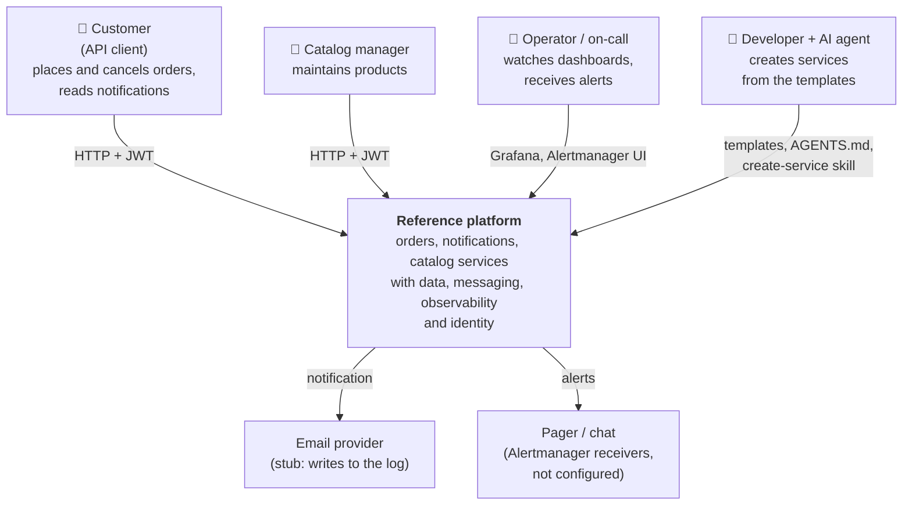
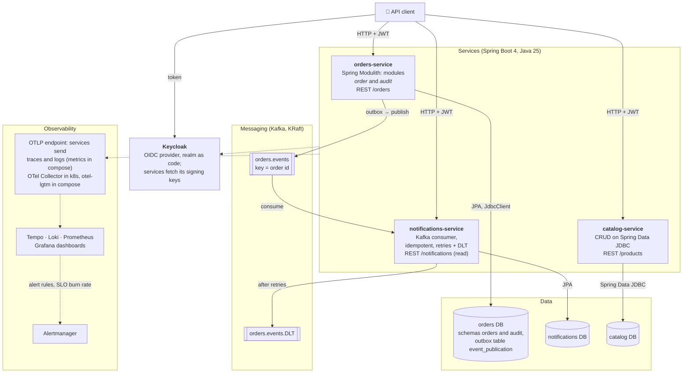
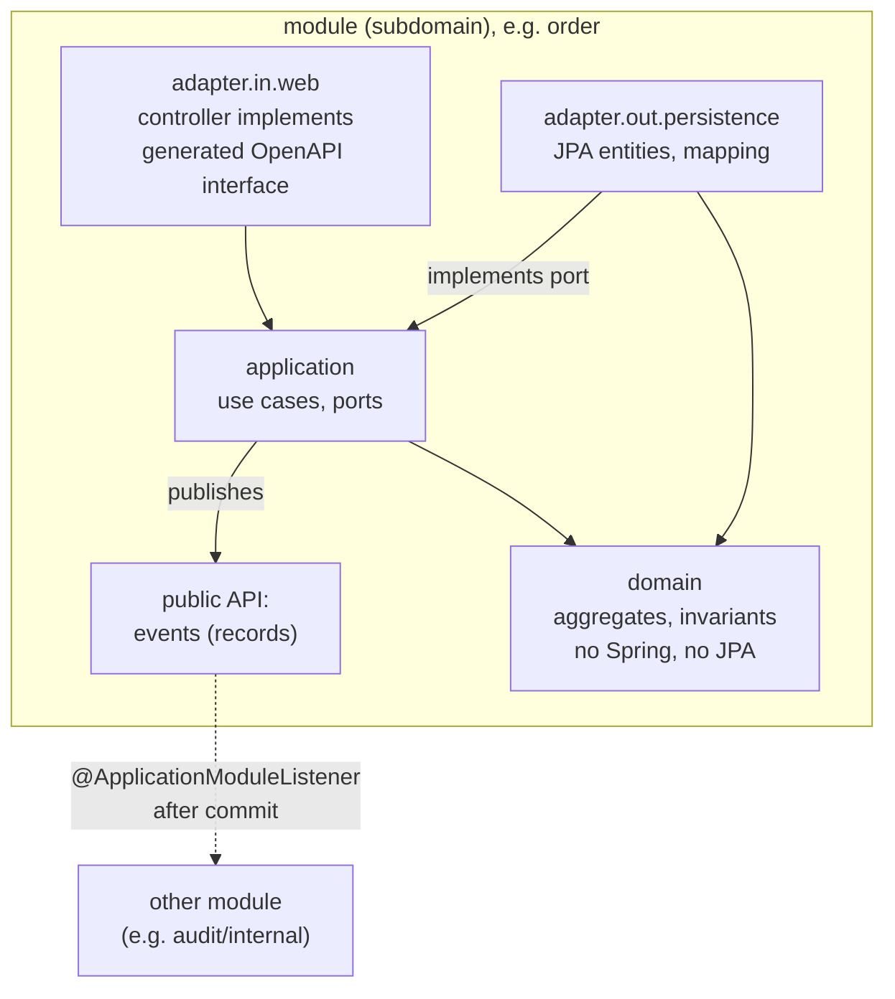
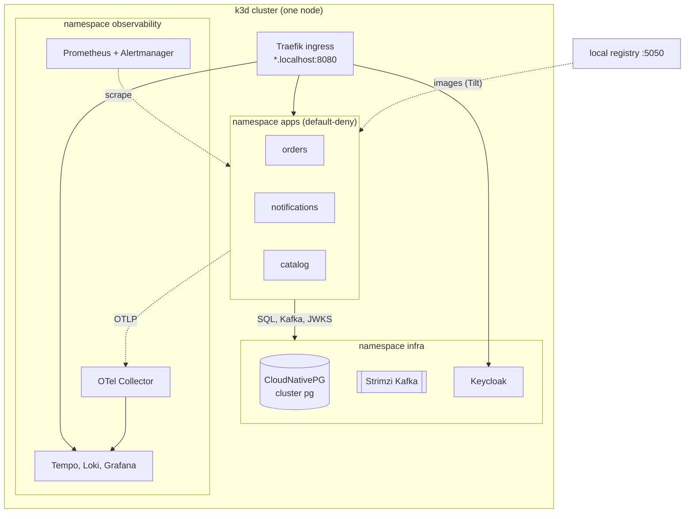
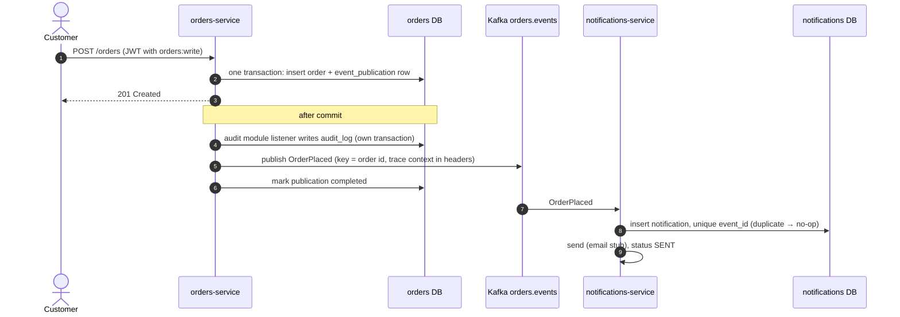
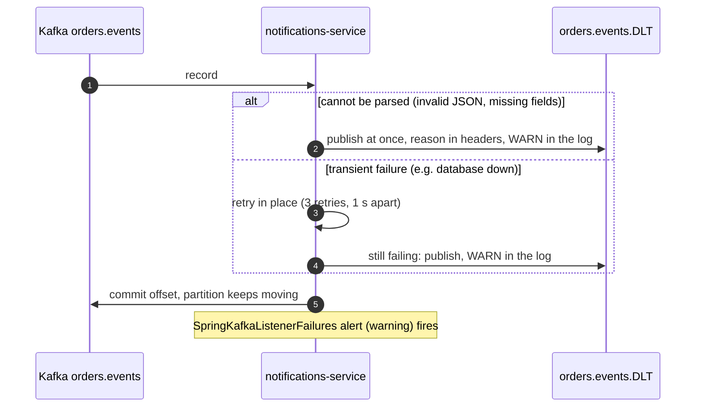

# Architecture overview

A lightweight [arc42](https://arc42.org/) description of the reference architecture: what it is for, which qualities drive it,
how it is structured (C4 diagrams in Mermaid), how the main scenarios run, and what is knowingly missing.
Decisions are recorded separately in [`docs/decisions.md`](../decisions.md); each one names the drivers below that it serves.

## 1. Goals

The repository is a reference architecture and a service template for Java microservices on Spring Boot.
It has to do two jobs at once:

1. **Show a production-like platform that actually runs**: three services, Postgres, Kafka, OpenTelemetry, dashboards, SLOs and alerts,
   on a laptop (Docker Compose) and on Kubernetes (k3d + Helm), from the same service artifacts.
2. **Be the starting point for new services**: "create service X" is answered by copying one of two templates
   (by script or by an AI agent following `AGENTS.md`), so that only the business logic needs a discussion.

| Reader | Wants to know |
|---|---|
| Architect, hiring manager | which qualities drive the design, what was considered, what is deliberately not done |
| Developer starting a service | which template to copy, which rules the build enforces, what "done" means |
| AI coding agent | the same as the developer, in a form it can follow and that tests can check (`AGENTS.md`) |
| Operator | how to see that a service is healthy and what an alert means (dashboards, SLOs, runbooks) |

## 2. Quality drivers

Ordered by priority. Each driver is stated as a scenario with a measurable response.
"Verified" means a manual run in both modes unless noted; "automated" means a check in the build.

| ID | Driver | Scenario (stimulus → response, measure) | Status |
|---|---|---|---|
| QD1 | **Fast, consistent service onboarding** | A developer or agent creates a service from a template → it builds, passes all tests and runs in both modes; it appears in the shared dashboard, alerts and SLOs **with no edits** to observability files. Target: one to two days for a service with real business logic | automated: scaffolded copies of both templates pass `./mvnw verify`; dashboards, rules and SLOs group by the `application` label |
| QD2 | **No lost business events** | An order is accepted → its `OrderPlaced` event reaches every consumer at least once, even if Kafka is down at that moment; a duplicate delivery changes nothing; a poison message does not block the partition | automated: `OutboxRedeliveryIntegrationTest` (Kafka paused → order → Kafka resumed → event delivered, no restart, D12); idempotency is tested; a broken message goes to the DLT (verified) |
| QD3 | **Observable by default** | Any request can be followed across services: one trace from HTTP through the outbox and Kafka to the consumer; every log line carries `trace_id`. A user-visible failure fires an SLO alert. Measure: availability 99.5 % and 99 % of requests under 500 ms over 28 days; in the outage test the fast-burn alert reached Alertmanager in about 3.5 minutes | verified; alert rules are unit-tested (`promtool test`, `pint`) |
| QD4 | **Architecture rules enforced by the build** | A change crosses a module boundary, puts JPA into the domain or a controller into persistence → `./mvnw verify` fails with a message that says what to do instead | automated: `ModularityTest`, `HexagonArchitectureTest`, `ArchitectureTest` |
| QD5 | **One artifact, two run modes** | The same jar and image run in Docker Compose and in Kubernetes; only environment variables differ. The same dashboard, rule and SLO files serve both modes | verified |
| QD6 | **Runs on a developer laptop** | `docker compose up` gives the whole system on one machine (about 3.5 GB of images); k3d runs on a single node; `make -C platform up` takes about 8 minutes with an empty image cache | verified on one laptop; not measured on a clean machine yet |
| QD7 | **Secure baseline** | A request without a valid token gets 401, a token without the permission gets 403; in Kubernetes a service can reach only what it needs (default-deny NetworkPolicy) | automated (401/403 per rule in web-slice tests); network isolation verified in k3d |
| QD8 | **Operable by an AI agent** | An agent follows `AGENTS.md` and the `create-service` skill; when it breaks a rule, a test fails, not a reviewer's patience | automated through QD4; the skill was used to build `notifications-service` and `catalog-service` |

## 3. Constraints

- **Team**: one architect-developer working with an AI coding agent. Conventions must be checkable by tests, not by review alone.
- **Hardware**: a single laptop. One Kubernetes node, no high availability, small memory limits, ephemeral Kafka storage in k3d.
- **No cloud account and no paid services**: everything is open source and starts locally. Managed services appear only as alternatives in decisions.
- **Stack**: Java 25, Spring Boot 4.1, Spring Modulith 2.1, Maven, Postgres, Kafka; this is the stack the template is meant to teach.
- **Production-like, not production**: demo passwords, Keycloak in dev mode and one database user are accepted and listed in [`security/README.md`](../../security/README.md).

## 4. Context (C4 level 1)

## 5. Containers (C4 level 2)

| Container | Responsibility | Template |
|---|---|---|
| `orders-service` | order lifecycle (place, cancel), audit log, publishes `OrderPlaced` / `OrderCancelled` | template 1: Modulith, domain model, light hexagon (D6) |
| `notifications-service` | reacts to order events, keeps notification state `PENDING → SENT / FAILED` | template 1, consumer variant |
| `catalog-service` | product catalog with optimistic locking and paging | template 2: CRUD on Spring Data JDBC, no Modulith (D8) |
| Postgres | one database per service; inside a service, one schema per module | |
| Kafka | `orders.events` (3 partitions) and its dead-letter topic | Strimzi in k8s (D3) |
| Keycloak | users, groups, permissions as realm roles `<service>:<action>` in the `permissions` claim | D11 |
| Observability | OTLP for traces and logs, Prometheus for metrics, one dashboard and one rule set for all services | D9, D10 |

Inside a template-1 service the structure is fixed and checked by tests (QD4):

## 6. Deployment

Both modes run the same images; addresses come from environment variables (QD5).

| | Docker Compose (`compose/`) | Kubernetes (`platform/`, k3d) |
|---|---|---|
| Purpose | daily development and demos | showing the platform: operators, Helm, NetworkPolicy |
| Postgres | one `postgres:17` container, a database per service from init scripts | CloudNativePG cluster `pg`, a `Database` resource per service |
| Kafka | `apache/kafka-native` single node | Strimzi, KRaft, `KafkaTopic` from each service's values |
| Observability | `grafana/otel-lgtm` (all-in-one) + Alertmanager container; services push metrics over OTLP | kube-prometheus-stack, Loki, Tempo, OTel Collector; Prometheus scrapes `/actuator/prometheus` |
| Identity | Keycloak container | Keycloak in `infra` |
| Services | profile `apps`, ports 8080–8082 | shared Helm chart `charts/spring-service`, Tilt, ingress `*.localhost:8080` |
| Network | one Docker network | namespace `apps` is default-deny; each service may reach `infra`, the collector and DNS |

## 7. Runtime scenarios

### 7.1 Order placed → notification (outbox, Kafka, idempotent consumer)

The trace started by the HTTP request continues through the Kafka headers, so Tempo shows one trace across both services,
and Loki finds the log lines of both by the same `trace_id` (QD3).

### 7.2 Consumer failure → retries → dead-letter topic

### 7.3 A user-visible outage → alert

When a service's database is stopped, requests fail. The availability SLO burns its error budget:
the fast multi-window burn-rate alert `HttpAvailabilityBudgetBurn` (critical) goes to the pager and chat receivers,
and the cause alert `SpringDbPoolExhausted` (warning) goes to chat. Measured times are in [`docs/alerting.md`](../alerting.md).

## 8. Cross-cutting concepts

- **Contracts first.** HTTP: `openapi.yaml` → generated interfaces and DTOs; errors as `application/problem+json`.
  Events: records with `eventId` and `occurredAt`, topic `<module>.events`, key = aggregate id. Database: Flyway migrations, `ddl-auto: validate`.
- **Modules and boundaries.** A module is a subdomain; its public API is its root package; modules talk through events after commit. Each module owns its tables.
- **Observability conventions.** The `application` metric tag, histogram buckets and the 500 ms SLO bucket are part of the template,
  so dashboards, rules and SLOs need no per-service edits (QD1, QD3).
- **Security.** Every service is an OAuth2 resource server; access rules live in one `SecurityConfig` per service; permissions come from the token.
- **Configuration.** External addresses only through environment variables; defaults point to `localhost`; the service does not know its run mode.
- **Rules as tests.** Architecture, alert rules and their labels are checked automatically (QD4, QD8).

## 9. Decisions

Recorded in [`docs/decisions.md`](../decisions.md). Mapping to drivers:

| Decision | Drivers |
|---|---|
| D1 Helm, shared chart | QD1, QD5 |
| D3 Strimzi; CloudNativePG | QD5, QD6 |
| D4 k3d + Tilt | QD6 |
| D5 Maven | QD1 |
| D6 modules by subdomain, light hexagon, two templates | QD1, QD4, QD8 |
| D7 test pyramid | QD2, QD4 |
| D8 JPA in template 1, Spring Data JDBC in template 2 | QD1, QD8 |
| D9 dashboards as code, one set for both modes | QD1, QD3, QD5 |
| D10 Prometheus rules, Alertmanager, SLOs via Pyrra | QD3 |
| D11 Keycloak, resource server in every service, NetworkPolicy | QD7 |
| D12 outbox: scheduled resubmission, delete on completion | QD2 |

## 10. Risks and technical debt

Known and accepted for now; each has a condition for fixing it.

| ID | Risk or debt | Impact | Plan |
|---|---|---|---|
| R1 | Outbox (after D12): with several replicas a restart republishes rows still in flight on other replicas; no metric or alert on the outbox backlog yet | duplicate deliveries (absorbed by idempotent consumers); a long outage is visible only through the Kafka send errors | backlog gauge (`event_publication` row count) and an alert, together with the broker outage experiment (B8) |
| R2 | The event contract is implicit: the consumer resolves the type from the producer's Java class name (`__TypeId__`) | renaming a record or a consumer in another language breaks integration | explicit type header (CloudEvents) and JSON Schema / AsyncAPI, checked in producer tests |
| R3 | Services are copies of a template with no upgrade path; versions live in each `pom.xml` | ten services drift to ten stacks | parent POM / BOM and one internal starter |
| R4 | No variant for a synchronous call to another service | the template covers only event-driven integration | `RestClient` / HTTP interface with timeouts, retry, circuit breaker and a contract test |
| R5 | SLOs are declared but not confirmed under load; latency SLO and consumer lag never exercised | QD3 targets are not evidence yet | load test and fault experiments |
| R6 | Single replica, no PodDisruptionBudget or autoscaling; Kafka storage in k3d is ephemeral | not representative of production availability | out of scope for a laptop; chart options when needed |
| R7 | Deployment to Kubernetes is driven from the laptop (Tilt); no CI yet | the "change in git reaches the cluster" path is not shown | CI with the architecture and alerting checks, then GitOps with Flux |
| R8 | Security gaps listed in [`security/README.md`](../../security/README.md): no ownership checks, no service-to-service auth, no Kafka ACLs, secrets not encrypted | acceptable for one trusted local platform only | close per the conditions listed there |
| R9 | The service image is built from a prebuilt jar; `grafana/otel-lgtm` is not pinned | `docker build` from a clean clone needs a Maven build first; compose may change under you | decide on the image build in an ADR; pin the image |
| R10 | Infrastructure versions differ between modes: Kafka 4.0 in compose and tests but 4.3 in k3d; PostgreSQL 17 in compose and tests but 18 in k3d (CNPG default image, not pinned) | a bug can show up in one mode only; QD5 holds for the service artifact, not for the infrastructure | pin one version per component for compose, Testcontainers and the cluster |
