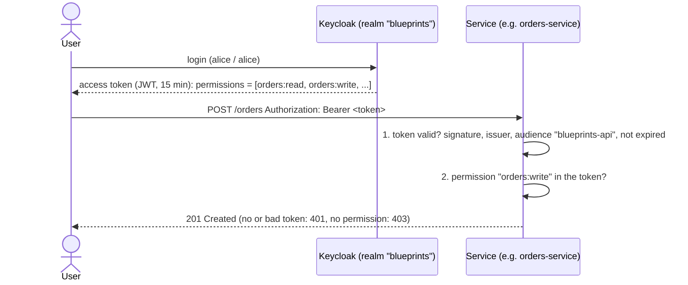

# Security

Every API call needs an access token. Keycloak issues the token to a user, each service checks it
and decides by the user's permissions. Inside Kubernetes, network policies allow a service to talk only
to what it needs. Decision record: D11 in `docs/decisions.md`.

## How a request is checked



- **Step 1 is configuration**, not code: `spring.security.oauth2.resourceserver.jwt` in each service's `application.yaml`.
  The signing keys are fetched from Keycloak and cached.
- **Step 2 is one method**: `SecurityConfig` in the root package of each service. The whole access policy of a service is there.
- Health probes and `/actuator/prometheus` are open, so Kubernetes and Prometheus need no token.
- Kafka events between services are trusted: they come from inside the platform (see "Not covered").

## Demo users

| User | Group | Permissions |
|---|---|---|
| `alice` / `alice` | customers | `orders:read`, `orders:write`, `notifications:read`, `catalog:read` |
| `bob` / `bob` | catalog-managers | `catalog:read`, `catalog:write` |

Users, groups and permissions are code: `keycloak/realm-blueprints.json`, the same file for compose and k3d.
Passwords and the Keycloak admin (`admin` / `admin`) are for a local demo only.

## Try it

```bash
# compose (Keycloak: http://localhost:8180)
TOKEN=$(security/token.sh alice)
curl -i -X POST localhost:8080/orders -H "Authorization: Bearer $TOKEN" -H 'Content-Type: application/json' \
  -d '{"customerId":"c-1","lines":[{"productCode":"A","quantity":1,"unitPrice":9.99}]}'      # 201
curl -i -X POST localhost:8080/orders -H 'Content-Type: application/json' -d '{}'           # 401: no token
curl -i -X POST localhost:8082/products -H "Authorization: Bearer $TOKEN" \
  -H 'Content-Type: application/json' -d '{"code":"A-1","name":"Mug","price":7.5}'          # 403: alice can't change the catalog

# k3d (Keycloak: http://keycloak.localhost:8080, services: http://<name>.localhost:8080)
TOKEN=$(KEYCLOAK_URL=http://keycloak.localhost:8080 security/token.sh alice)
curl -i http://orders.localhost:8080/orders/<id> -H "Authorization: Bearer $TOKEN"
```

To read a token, paste it into https://jwt.io or run `cut -d. -f2 <<<"$TOKEN" | base64 -d`.
In Tempo a request shows the security steps as spans: `authenticate bearertoken`, `authorize request`.

## Who may call what

| Service | Request | Permission |
|---|---|---|
| orders-service | `GET /orders/**` | `orders:read` |
| orders-service | `POST /orders`, `POST /orders/{id}/cancel` | `orders:write` |
| notifications-service | `GET /notifications/**` | `notifications:read` |
| catalog-service | `GET /products/**` | `catalog:read` |
| catalog-service | `POST`, `PUT`, `DELETE /products/**` | `catalog:write` |

The same is written in each `openapi.yaml`: `security: accessToken`, the permission in the operation's description, responses 401 and 403.

## Add an endpoint or a permission

1. **Realm** (`keycloak/realm-blueprints.json`): a new permission is a realm role named `<service>:<action>`;
   give it to a group in `groups`.
2. **Access rule** (`SecurityConfig`): one `requestMatchers(...).hasAuthority("<permission>")` line.
3. **Contract** (`openapi.yaml`): the permission in the operation's description, responses `401` and `403`.
4. **Test** (`@WebMvcTest` of the controller): requests use `.with(token("<permission>"))`;
   one test for 401 (no token) and one for 403 (another permission) per rule.
5. **Reload the realm**: compose `docker compose -f compose/compose.yaml up -d --force-recreate keycloak`,
   k3d `make -C platform security && kubectl -n infra rollout restart deployment/keycloak`.
   (Keycloak runs in dev mode and imports the realm on start; a plain restart keeps the old one.)

## Network (k3d)

| Who | May connect to |
|---|---|
| a service in `apps` | DNS, namespace `infra` (Postgres, Kafka, Keycloak), OTel Collector port 4318 |
| ingress controller, Prometheus | a service's HTTP port |
| anything else | nothing: namespace `apps` is closed by default (`platform/manifests/apps/default-deny.yaml`) |

The rules are in the Helm chart (`charts/spring-service`, `networkPolicy` in `values.yaml`), so every service gets them.
A new service without a policy is isolated, not open. Compose has no network policies.

## Where things are

| File | What |
|---|---|
| `keycloak/realm-blueprints.json` | realm: permissions, groups, demo users, client `blueprints-cli` |
| `token.sh` | prints a token of a demo user |
| `services/*/src/main/java/.../SecurityConfig.java` | access policy of a service |
| `services/*/src/main/resources/application.yaml` | token checks: issuer, keys, audience, permissions claim |
| `services/*/src/test/java/.../TestTokens.java` | `token("orders:write")` for MockMvc tests |
| `compose/compose.yaml`, `platform/manifests/keycloak.yaml` | Keycloak in each mode (`make -C platform security`) |
| `charts/spring-service/templates/networkpolicy.yaml` | network policy of a service |

## Threat model (short)

| Threat | What protects | Status |
|---|---|---|
| Anonymous call to the API | token required on every endpoint except probes and metrics | done |
| Forged or expired token | signature by Keycloak keys, issuer, audience, expiry | done |
| User does more than allowed | permission per endpoint; 403 | done |
| Token issued for another application | audience `blueprints-api` required | done |
| Compromised pod scans the cluster | NetworkPolicy: only infra, OTel and DNS | done (k3d) |
| Customer reads or cancels another customer's order | ownership check (customer id from the token) | **not covered** |
| Service impersonates another service, forged Kafka event | service-to-service auth, Kafka ACL | **not covered** |
| Secrets read from git or the cluster | encrypted secrets (SOPS) | **not covered** yet |

## Not covered (on purpose)

| Gap | Why it is acceptable here | When to close it |
|---|---|---|
| Ownership: `customerId` comes from the request body, not from the token | the template shows the mechanism; ownership is a business rule of each domain | first real customer-facing API |
| Service-to-service auth (client credentials or mTLS) | services call each other only through Kafka inside the platform | a synchronous call between services or a third party |
| Kafka authentication and ACLs (Strimzi `KafkaUser`) | one trusted platform | several teams or tenants on one cluster |
| Encrypted secrets in git (SOPS + age) | planned together with GitOps (Argo CD); the tool (SOPS via KSOPS or helm-secrets, Sealed Secrets, External Secrets) is chosen in an ADR | with GitOps |
| One database user `app` for all services | local platform; schemas are separated | a shared or production database |
| Keycloak in dev mode, password grant, demo passwords | quick local start | any shared environment: production mode, own database, authorization code flow |
| API gateway, rate limiting, image signing | out of scope of the template | public exposure, supply-chain requirements |
